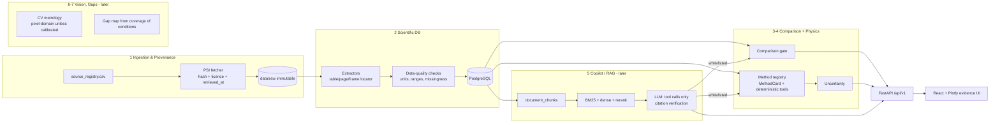
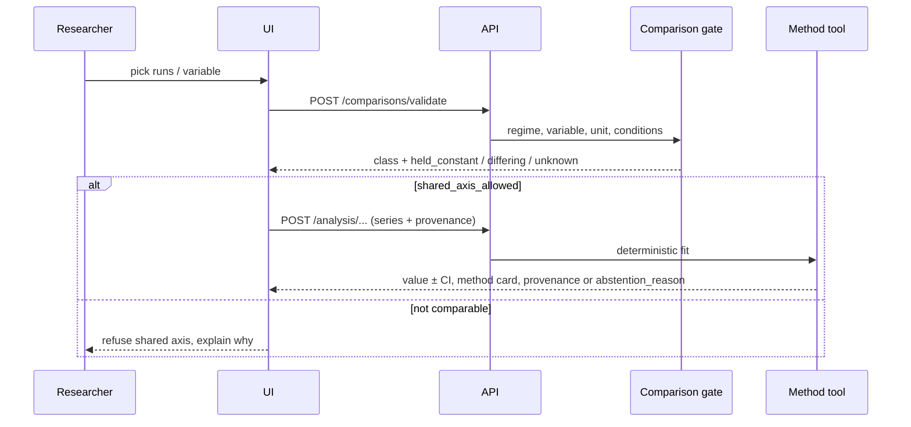
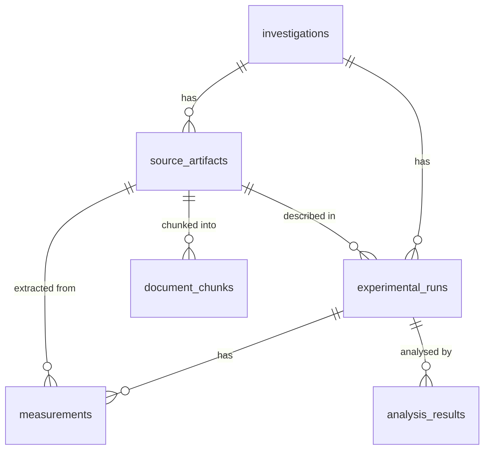

# 08 — Architecture Audit & Target Design (2026-11-13)

Scope: the code in this repository, verified by reading it and running checks. Nothing below is
called implemented unless code and a test exist.

## 1. Current state

| Boundary | Status | Evidence |
|---|---|---|
| 1. NASA ingestion & provenance | **Partial** | `scripts/audit_local_data.py` (hash inventory). Registry CSV now typed and validated (`app/domain/sources.py`). No downloader, no raw files, and the official challenge resource is not recorded. |
| 2. Scientific DB & data quality | **Planned** | `database/schema.sql` only. No SQLAlchemy models, migrations, Postgres service or loader. |
| 3. Evidence retrieval & comparison | **Partial** | Deterministic comparison gate (`app/domain/comparison.py`, `POST /comparisons/validate`). No retrieval. |
| 4. Physics & uncertainty | **Partial** | One method: d²-law K fit with WLS/OLS uncertainty and abstention (`app/science/droplet.py`). Method-card contract (`app/science/method_cards.py`). Not validated on NASA data. |
| 5. Copilot & RAG | **Planned** | Nothing in code. |
| 6. Flame vision & metrology | **Planned** | Nothing in code. |
| 7. Gap discovery & experiment design | **Planned** | Nothing in code. |
| 8. Frontend / viz / reporting | **Partial** | React + TypeScript/Vite scientific exploration lab with Plotly Cartesian charts, a filter-aware Analysis Results view over the audited Python strata export, and a comparison plot shown only after fresh backend validation explicitly allows a shared axis. Includes retryable dataset loading, refreshed API health state, section-change focus management, a keyboard-managed evidence inspector, record-level NASA table/caption citations, acquisition and processing provenance, filters, tables, exports, responsive/theme support, source/regime/method API panels, and searchable FLEX run records (`frontend/src`). The FLEX measurements and analysis strata still come from the versioned static export. |
| Infra | **Partial** | Git is initialized and `LICENSE` is present; Dockerfile/compose and CI are absent. |
| Tests | Backend pytest suite; frontend Vitest unit suite (including typed API contract/error cases) and Playwright E2E/accessibility/performance/visual suites. `scientific-exploration.spec.ts` covers registry loading/error/retry, experiment evidence/provenance, and valid/rejected comparison display (`frontend/package.json`, `frontend/tests`). No ESLint configured. |

Defects found at baseline:
1. `npm run build` failed: missing `src/vite-env.d.ts` (`import.meta.env` untyped). **Fixed.**
2. `/status.official_challenge_resource_recorded` was hard-coded `False`, so it would still say
   `False` after the resource was registered. **Fixed:** the flag is now derived from the registry.
3. Registry rows were returned as untyped dicts, and nothing stopped a row being marked verified
   without a hash or licence. **Fixed:** Pydantic contract; `ACQUIRED`/`VERIFIED` require URL,
   retrieval time, licence, path and SHA-256.
4. Schema let a run carry `outcome_value` without a unit, locator or method, duplicating
   `measurements`. Regime was free text. **Fixed** in `schema.sql` (regime CHECK, outcome columns
   removed, uncertainty type/coverage, `analysis_results`, `document_chunks`).
5. README gave Nov 13 as the resource date; the GO Team said Nov 12. **Fixed.**
6. PSI-98 metadata is internally inconsistent. Acronym, hardware and approach text describe
   Saffire-1 on Cygnus, but the proposal title (smoke characterisation) and dates (2001-02-03 to
   2008-02-28, PSI MM-DD-YYYY) do not fit. NASA NTRS 20170000230 and 20170001636 place Saffire
   development from 2012, with launches planned for 2016. **Quarantined:** registry status
   `QUARANTINED`; the original PSI responses are preserved unmodified (gitignored, since they
   contain contact emails) with SHA-256 in `data/metadata/psi_metadata_snapshot.json`; the analysis
   API refuses PSI-98. The exact Saffire-I operation date was not confirmed from a NASA source.
7. SciPy could not be installed (PyPI throughput ≈4 KB/s; 36.7 MB wheel). Its only use was the
   Student-t quantile, so that is now `app/science/stats.py`, tested against t-table values. SciPy
   was removed from core dependencies; re-add it when a method genuinely needs it.

### Reference verification (2026-11-13)

| Reference | Check | Result |
|---|---|---|
| PSI DOIs 10.60555/mbq8-0451, /4qc4-de67, /0t15-1z43 | doi.org resolution | 302 → PSI-69 / PSI-25 / PSI-98 ✔ |
| Godsave 1953, Proc. Combust. Inst. 4:818–830, 10.1016/S0082-0784(53)80107-4 | Crossref | title/vol/pages match ✔ |
| Law 1982, PECS 8:171–201, 10.1016/0360-1285(82)90011-9 | Crossref | title/vol/pages match ✔ |
| NTRS 20170000230, 20170001636 | NTRS API | abstracts read ✔ |
| NASA/TP-2015-216046 (FLEX detailed results), NTRS 20150023456 | PDF read (sha256 b4f6ca98…) | Appendix A.1 + Table IX resolve the PSI-69 burning-rate unit (mm²/s) and CO→CO2 ✔; 274/274 PSI rows match Table IX |
| spaceappschallenge.org legal + challenge pages | browser/curl | **not read** (TLS certificate untrusted on this machine) |
| Saffire-I operation date "June 2016 / Cygnus OA-6" | — | **unverified, excluded** from code and registry |

## 2. Target architecture (modular monolith)

### Core request workflow

Decisions:
- **Keep the stack**, but add libraries only when a feature needs them. NumPy is now a core
  dependency; SciPy is deferred (see defect 7). Pandas stays optional. Qdrant, BGE, LLM and
  OpenCV are not added until their gate (docs/02) is reached.
- **No agents or microservices.** The LLM gets a fixed whitelist of tools whose arguments are
  Pydantic models, and it never produces numbers itself.
- **Every result carries provenance.** Analysis endpoints reject a request (422) unless it includes
  `provenance.source_id`, `source_locator` and `extraction_method`.
- **Abstention is a first-class response:** `computable=false` plus a reason, not an HTTP error and
  not a guess.

## 3. ERD review

Remaining schema gaps (backlog): a `variables` table mirroring `app/domain/regimes.py` with an FK
from `measurements.variable_name`; a `units` table; `extraction_runs` (tool version, parameters,
operator); a join table for `analysis_results` inputs instead of a `BIGINT[]` array, if referential
integrity is needed; and SQLAlchemy models plus Alembic migrations generated from this file.

## 4. API contracts (implemented)

| Method | Path | Contract |
|---|---|---|
| GET | `/health` | liveness |
| GET | `/api/v1/status` | flags derived from registry; `scientific_dataset_loaded` stays false until the loader exists |
| GET | `/api/v1/sources` | `SourceRecord[]` (validated) |
| GET | `/api/v1/regimes` | regime id, description, allowed variables |
| POST | `/api/v1/comparisons/validate` | `{a,b: ObservationDescriptor}` → `ComparisonResult` |
| GET | `/api/v1/methods` | `MethodCard[]` |
| POST | `/api/v1/analysis/droplet/burning-rate-constant` | `DropletSeries` → `BurningRateResult`. Requires `regime=flex_droplet`, `time_unit=s`, `diameter_unit=mm`, `fuel`, `window_selection`, provenance. 422 if the source is registered but not ACQUIRED/VERIFIED (candidate or QUARANTINED); unregistered ids are computed with a "not traceable" warning. The result echoes assumptions, validity limits, warnings and `validation_status`. |

The frontend's `src/api/client.ts` provides typed client methods for sources, regimes, methods and comparison validation. Scientific Explorer consumes the first three endpoints; Compare Runs sends selected FLEX descriptors to the comparison endpoint and displays its classification, reasons, held-constant, differing and unknown fields. Its Plotly K comparison is rendered only for the current run pair after the backend returns `shared_axis_allowed=true`; pending, failed, stale, and rejected validation states show no shared chart. The comparison plot also has a table alternative with evidence-inspector actions. Analysis Results displays descriptive Spearman statistics and source PSI-row links from the versioned Python export; it does not calculate statistics in the browser. Existing Plotly panels cover burning-rate trends, oxygen, pressure and diluent conditions, experimental distributions, and coverage counts. Dataset loading can be retried, API health is rechecked while the page is visible, and section navigation moves keyboard focus to the new main content. FLEX measurements continue to load from the versioned static export. Unknown apparatus metadata is left unset so the backend classifies the pair conservatively. The evidence inspector links records to NASA report pages and exposes source DOI, dataset file/version, retrieval date, raw-file hash, and collapsible processing fingerprints from the exported provenance contract.

## 5. RAG / AI review (no code yet, so these are design constraints)

- Pipeline: metadata filter (investigation, regime) → BM25 + BGE-M3 → RRF fusion → BGE reranker
  v2-M3 → evidence validation (chunk must map to a registered artifact) → LLM → citation check
  (each cited chunk_id must exist and contain the quoted span).
- Chunk by page/section and keep table rows intact. Store `chunker_version` so evaluations are
  reproducible.
- Before tuning, build 30–50 questions labelled with the supporting chunk IDs. Report
  BM25-only vs hybrid Recall@K/MRR on a held-out split. **No metrics exist yet; none are claimed.**
- Fine-tuning (embeddings, reranker, LoRA) only if that evaluation shows a persistent failure and
  enough labelled data exists. That will not happen in the hackathon window.

## 6. Security & licensing risks

| Risk | Severity | Mitigation |
|---|---|---|
| No LICENSE file | High (submission) | Add an OSI licence; confirm the requirement in the global terms. |
| PSI contacts JSON includes personal emails | Medium | Do not store or display contact PII. Ingest only scientific metadata. |
| LLM prompt injection from source PDFs | Medium (later) | Treat retrieved text as data; allow tool calls only from the whitelist; validate arguments with Pydantic. |
| CORS allows only `localhost:5173`, GET/POST, `Content-Type` header | Low | Make it configurable through an env var for deployment. |
| Unpinned model weights/licences | Medium (later) | Pin the revision hash and record the licence in the registry before use. |
| NASA branding / endorsement | High | Keep the non-endorsement notice; no NASA logos; AI-generated media must be watermarked. |

## 7. Prioritised backlog

1. **Gate 0:** open the challenge Resources tab in a browser and record ≥1 NASA source (URL, version, licence, SHA-256). Blocks every demo claim.
2. ~~Download and profile the three PSI experimental tables~~ **Done 2026-11-13**; see [09_psi_table_profile.md](09_psi_table_profile.md). Both FLEX ambiguities were resolved 2026-11-13 from NASA/TP-2015-216046 (see doc 09).
3. Choose the MVP regime from that profile. If FLEX provides D(t) or K values, validate the d²-law tool against a published FLEX K before showing it.
4. SQLAlchemy models + Alembic + docker-compose (Postgres + API). Loader from verified CSVs into `measurements` with quality flags.
5. Evidence UI: comparison-gate view and record-level source/report citations are implemented; a planned Plotly comparison chart must refuse a shared axis when `shared_axis_allowed=false`, with source links on every point.
6. BM25 baseline over the PSI publication list and abstracts, plus a labelled evaluation set. Add dense retrieval/reranking only if the evaluation shows a gap.
7. LLM copilot restricted to the existing tools, with citation verification and abstention.
8. CV metrology and gap discovery: roadmap only for the hackathon.
